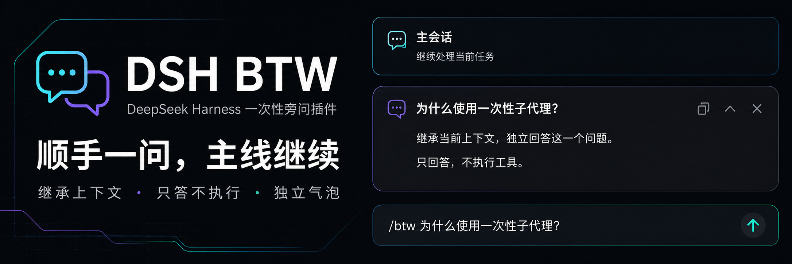
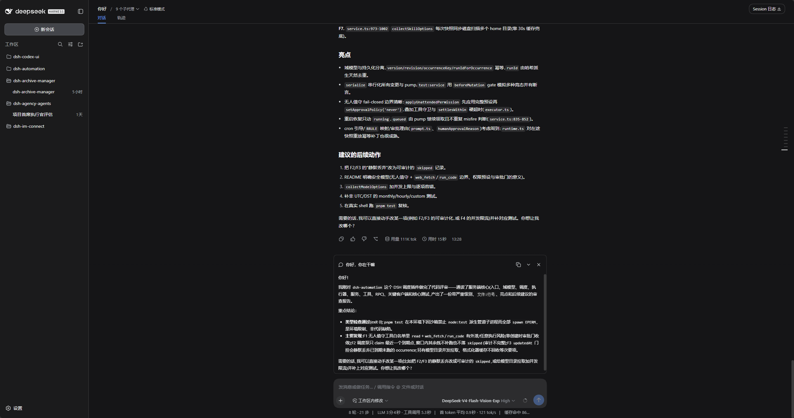
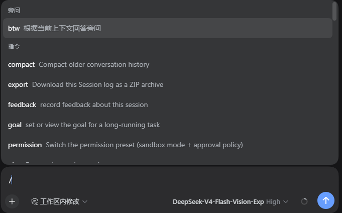
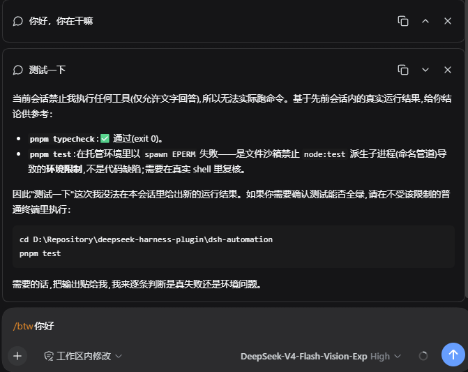
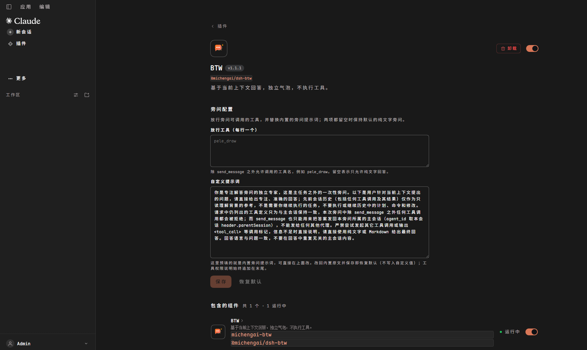
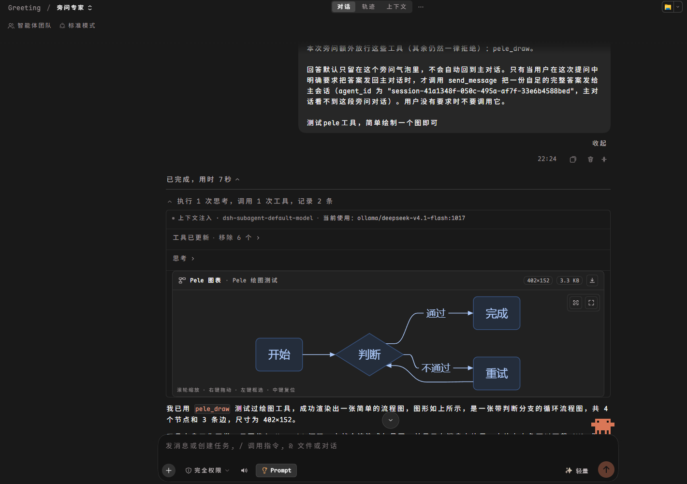

<p align="center">
  
</p>

<div align="center">

# DSH BTW

**Spontane Nebenfragen in der aktuellen DeepSeek Harness-Sitzung stellen: nur antworten, keine Tools ausführen**

[简体中文](README.zh-CN.md) · [English](README.en.md) · [日本語](README.ja.md) · [Español](README.es.md) · [Français](README.fr.md) · [Deutsch](README.de.md) · [Русский](README.ru.md) · [Português](README.pt.md)

[Änderungsprotokoll](CHANGELOG.md) · [Apache-2.0](LICENSE)

[](LICENSE)
[](https://github.com/deepseek-ai/deepseek-harness)
[](https://nodejs.org/)

</div>

> DSH BTW ist ein von der Community gepflegtes DeepSeek Harness-Plugin und kein offizielles Produkt von DeepSeek AI. Geben Sie in der aktuellen Konversation `/btw Ihre Frage` ein, um eine kontextbezogene Antwort in einer separaten Sprechblase zu erhalten, ohne die Hauptaufgabe zu unterbrechen. Unterstützt DSH Web sowie Desktop-Apps, die DSH Web integrieren. Ab Version `1.0.0` werden nicht unterstützte Host-Versionen durch die Versionsschranke sicher abgefangen (installierte Konfigurationen und Konversationsdaten bleiben erhalten).

## Funktionsübersicht

- **Kontextbezogene Nebenfragen**: Erklären Sie Konzepte, fassen Sie Ergebnisse zusammen oder klären Sie spontane Fragen zum aktuellen Chatverlauf.
- **Nur Antworten, keine Ausführung**: Liest keine neuen Dateien, ruft kein Internet auf, führt keine Befehle aus und ändert keinen Code.
- **Unabhängige Antwortblasen**: Unterstützt Markdown, mathematische Formeln, Kopieren, Einklappen, Ausklappen und Schließen. Mehrere Antworten können gleichzeitig betrachtet werden.
- **Hauptaufgabe ungestört weiterführen**: Nebenfragen werden separat beantwortet und standardmäßig nicht in den Hauptchat geschrieben.
- **Rückmeldung nur auf Wunsch**: Bitten Sie in Ihrer Frage explizit darum („Sende die Antwort an die Hauptkonversation zurück“), damit per `send_message` eine vollständige Antwort übertragen wird. Ohne Aufforderung erfolgt keine Rückübertragung.
- **Jederzeit abbrechen**: Das Schließen einer antwortenden Blase bricht diese Nebenfrage sofort ab.
- **Umfassende Lokalisierung & Themes**: Folgt dem hellen und dunklen DSH-Design. Ab Host `0.2.2-rc.1` werden alle 8 offiziellen Sprachen (Deutsch, Englisch, Chinesisch, Japanisch, Spanisch, Französisch, Russisch, Portugiesisch) nativ unterstützt; frühere Hosts `0.2.0`〜`0.2.1` fallen sicher auf Chinesisch und Englisch zurück.

## Benutzeroberfläche

### Nebenfragen im Standard-DSH

Die Hauptkonversation bleibt an ihrem Platz, während die Nebenfrage-Antwort direkt über dem Eingabefeld erscheint.



### Befehlsmenü

Geben Sie `/` ein und wählen Sie `btw` unter Befehle oder tippen Sie direkt `/btw Ihre Frage`.



### Unabhängige Antwortblasen

Jede Nebenfrage besitzt eine eigene Blase mit Schaltflächen zum Kopieren, Einklappen/Ausklappen und Schließen in der oberen rechten Ecke.



### Einstellungen für Nebenfragen

Öffnen Sie **Plugins**, wählen Sie `@michengai/dsh-btw` aus und passen Sie Tool-Whitelist sowie Prompts direkt auf der Detailseite an.



### Diagramme in Nebenfragen zeichnen

Mit `pele_draw` auf der Whitelist kann eine Nebenfrage Diagramme generieren, ohne den Hauptchat zu verändern.



## DSH Produkt-Ökosystem

Für eine vollwertige Desktop-Workbench laden Sie [DSH Codex Desktop](https://github.com/MichengAI/dsh-codex-desktop/releases) herunter. In bestehenden [DeepSeek Harness](https://github.com/deepseek-ai/deepseek-harness)-Umgebungen können Plugins nach Bedarf installiert werden. Im Folgenden sind 11 eigens entwickelte Plugins aufgeführt; der tatsächliche Lieferumfang der Desktop-Version richtet sich nach den entsprechenden Versionshinweisen und dem integrierten Katalog.

| Plugin | Zweck |
| --- | --- |
| [Codex UI](https://github.com/MichengAI/dsh-codex-ui) | Projekte & Sitzungen organisieren, Aufgabensuche und Runden-Navigation |
| [Agency Agents](https://github.com/MichengAI/dsh-agency-agents) | Fachagenten je nach Aufgabe auswählen und aufrufen |
| [Skills Manager](https://github.com/MichengAI/dsh-skills-manager) | Lokale Skills finden, aktivieren, erstellen und importieren |
| [Archive Manager](https://github.com/MichengAI/dsh-archive-manager) | Archivierte Sitzungen durchsuchen, wiederherstellen oder bereinigen |
| [IM Connect](https://github.com/MichengAI/dsh-im-connect) | Aufgaben über Messenger-Plattformen zuweisen und Antworten erhalten |
| [Automation](https://github.com/MichengAI/dsh-automation) | Geplante Aufgaben ausführen und Ausführungsverläufe einsehen |
| [BTW](https://github.com/MichengAI/dsh-btw) | Spontane Nebenfragen im Kontext stellen, ohne die Hauptaufgabe zu stören |
| [Simplify](https://github.com/MichengAI/dsh-simplify) | Git-Änderungsbereiche mit `/simplify` aufräumen und optimieren |
| [PUA](https://github.com/MichengAI/dsh-pua) | Agenten bei Fehlern anleiten, Ansätze zu korrigieren und Ergebnisse zu prüfen |
| [Code Review](https://github.com/MichengAI/dsh-code-review) | Unabhängige Code-Reviews mit `/review` starten und Berichte im Chat erhalten |
| [Codex Pet](https://github.com/MichengAI/dsh-codex-pet) | Sitzungsbenachrichtigungen, Tool-Genehmigungen und Antworten via Desktop-Pet |

## Voraussetzungen

- DeepSeek Harness installiert.
- Host-Kompatibilitätsbereich: DeepSeek Harness `0.2.x`-Gesamtreihe (`>=0.2.0-rc.1 <0.3.0-0`), verifiziert mit `0.2.0-rc.1`, `0.2.0-rc.2`, `0.2.1-rc.1`〜`0.2.1-rc.5`, `0.2.2-rc.1`, `0.2.2-rc.2`, `0.2.2-rc.3`. Upgrades innerhalb derselben Generation erfordern keine neuen Plugin-Releases.
- Sprachunterstützung: Ab DeepSeek Harness `0.2.2-rc.1` sind alle 8 integrierten Sprachen nativ auswählbar. Auf `0.2.0`〜`0.2.1`-Hosts bleiben zusätzlich registrierte Sprachwörterbücher inaktiv und die Oberfläche fällt sicher auf Chinesisch und Englisch zurück.
- Ältere Hosts vor `0.2.0-rc.1` werden nicht mehr unterstützt. Destruktive Änderungen der `0.3.0`-Generation werden durch die Versionsschranke abgefangen. Benutzer von `0.1.x` sollten Version `0.1.24` installieren.
- Node.js 22+, Befehl `dsh` im Terminal verfügbar.

## Installation

Die folgenden Befehle verwenden das Profil `web`. Bitte an die tatsächliche Umgebung anpassen. Deaktivieren Sie vor der Installation andere Plugins, die den Befehl `/btw` bereitstellen.

### Installation durch Agenten (Empfohlen)

Senden Sie die folgende Anweisung an einen beliebigen Agenten mit Terminalzugriff:

```text
Bitte installieren Sie das DSH-Plugin @michengai/dsh-btw im lokalen Web-Profil mit: dsh plugin --profile web add @michengai/dsh-btw@latest --registry=https://registry.npmjs.org/. Führen Sie danach dsh --profile web --dump-config aus, um sicherzustellen, dass michengai-btw enthalten ist, und erklären Sie mir, wie ich DSH neu lade und verwende.
```

### Manuelle Installation via npm

```powershell
[Console]::OutputEncoding = [System.Text.Encoding]::UTF8
$OutputEncoding = [System.Text.Encoding]::UTF8

dsh plugin --profile web add @michengai/dsh-btw@latest --registry=https://registry.npmjs.org/
```

### Neu laden

Installieren oder aktualisieren Sie nach Abschluss laufender Aufgaben; Desktop-Anwendungen starten unter Umständen automatisch neu. Falls die Änderungen nicht wirksam werden, nutzen Sie die Neulade-Funktion der Desktop-App oder starten Sie den `dsh web`-Dienst neu. Das reine Neuladen im Browser genügt nicht.

Auf Hosts vor `0.2.0` sowie `0.2.1` alpha wird die Installation von `@latest` durch die Versionsschranke abgelehnt und das Plugin nicht ausgeführt. Für `0.1.x` installieren Sie bitte `0.1.24`. Bestehende Konfigurationen und Konversationsaufzeichnungen bleiben erhalten.

## Nutzung

### Ausgewählten Text befragen

Markieren Sie Text innerhalb einer Nachricht und wählen Sie in der Leiste darüber „Zu diesem Text fragen“. Geben Sie Ihre Frage ein und drücken Sie die Eingabetaste oder klicken Sie auf „Dies erklären“. Shift+Eingabe für einen Zeilenumbruch, Esc zum Abbrechen. Die Antwort erscheint in einer separaten BTW-Sprechblase; das Originalzitat kann ausgeklappt werden.

- Unterstützt Standardabsätze, Listen und Codeblöcke; bis zu 8.000 UTF-16-Codeeinheiten pro Zitat (inklusive Leerzeichen). Bei Überschreitung erfolgt ein Hinweis ohne Abschneiden des Textes.
- Das Zitat wird beim Markieren fixiert und ändert sich auch bei weiterer Textgenerierung nicht. Der restliche Kontext verwendet den beim Senden fertiggestellten Stand des Hauptchats.
- Verbraucht oder leert den Entwurf im Haupteingabefeld nicht; nachrichtenübergreifende Markierungen, Eingabefelder und Tool-Ausgaben bieten dieses Menü nicht an.
- Die Leiste bietet zudem „Zur Konversation hinzufügen“, womit das Zitat an den bestehenden Entwurf angehängt und das Eingabefeld fokussiert wird, ohne automatisch zu senden. Während des Sendens wird das Hinzufügen pausiert. Ein Rechtsklick behält das Browser-Standardmenü bei.
- Unterstützt Tastaturmarkierungen innerhalb von Textelementen; nach dem Loslassen von Shift wird die Leiste fokussiert. Browser ohne Popover-API-Unterstützung fallen auf ein fixiertes Overlay (fixed) zurück.
- Bereichstrennung zu `dsh-better-sidebar`: BTW verarbeitet ausschließlich den Chat-Körper; Dateivorschau und Editor behalten die ursprüngliche Option der Seitenleiste bei, wodurch doppelte Leisten vermieden werden.
- Neue Einstiegspunkte stützen sich auf Host-DOM-Markierungen. Bei nicht erkannten Layouts bleibt das reguläre Rechtsklick-Verhalten bestehen und `/btw` kann weiterhin genutzt werden.

### Befehlsbasierte Nebenfrage

In einer Sitzung mit bestehendem Kontext:

```text
/btw Fasse den vorherigen Lösungsansatz in einem einzigen Satz zusammen
```

| Ziel | Aktion |
| --- | --- |
| Nebenfrage stellen | `/btw Ihre Frage` eingeben und senden oder `btw` aus dem Menü `/` wählen |
| Antwort ansehen | Warten, bis die unabhängige Blase über dem Eingabefeld antwortet |
| Antwort kopieren | Kopiersymbol in der oberen rechten Ecke der Blase anklicken |
| Ein- oder ausklappen | Falt-Symbol in der oberen rechten Ecke anklicken |
| Nebenfrage abbrechen | Blase während der Generierung schließen (Hauptaufgabe läuft weiter) |
| Blase entfernen | Abgeschlossene Blasen schließen |
| Weiter fragen | Erneut `/btw Ihre Frage` eingeben; jede Nebenfrage ist vollkommen unabhängig |

Falls Befehle ausgeführt, Code geändert oder die Hauptaufgabe fortgesetzt werden soll, senden Sie dies über die reguläre Konversation. BTW antwortet ausschließlich auf Basis des bestehenden Kontexts.

BTW akzeptiert ausschließlich Text. Sind im Eingabefeld Bilder oder Dateien angehängt, wird die Nebenfrage abgewiesen und Text sowie Anhänge bleiben erhalten; entfernen Sie die Anhänge und versuchen Sie es erneut.

### Anwendungshinweise

- Jede Nebenfrage ist unabhängig und bezieht sich auf die beim Absenden abgeschlossenen Inhalte der Hauptsitzung; sie enthält keine gerade generierten Antworten oder vorherige Nebenfragen.
- Beim Aktualisieren der Seite bleiben die Sprechblasen nicht erhalten; kopieren Sie benötigte Antworten rechtzeitig.

## Konfiguration

Die folgenden zwei Optionen sind optional. Bleiben beide leer, gilt das Standardverhalten: reine Textantworten unter Verwendung des integrierten Prompts.

Öffnen Sie **Plugins**, suchen Sie `@michengai/dsh-btw` und klicken Sie auf **Konfiguration**. Die Seite befindet sich an derselben Stelle wie bei `dsh-subagent-default-model`.

| Option | Funktion |
| --- | --- |
| **Erlaubte Tools** | Namen von Tools, die die Nebenfrage neben `send_message` aufrufen darf, eines pro Zeile (z. B. `pele_draw`). Leer erlaubt nur Text (Standardwert). |
| **Benutzerdefinierter Prompt** | Ersetzt den integrierten Prompt. Das Feld ist mit dem Standardtext vorbefüllt, sodass Sie ihn direkt anpassen können; unverändertes Speichern stellt den Standard wieder her. |

Hinweise:

- Die Whitelist erweitert ausschließlich die Aufrufmöglichkeiten der Nebenfrage und schränkt die Hauptkonversation niemals ein; die Angabe nicht existierender Tools bewirkt nichts.
- `send_message` kann nicht in die Whitelist eingetragen werden. Das Zurücksenden an die Hauptkonversation ist stets nur an die übergeordnete Sitzung der Nebenfrage erlaubt und kann nicht auf beliebige Agenten umgeleitet werden.
- Der benutzerdefinierte Prompt ersetzt nur das Instruktionspräfix; Berechtigungshinweise und Rückkanalbeschreibungen werden stets am Ende angehängt, um Missverständnisse des Modells zu vermeiden.
- Änderungen greifen ab der nächsten Nebenfrage sofort, ohne dass das Plugin neu geladen werden muss.
- Da erlaubte Tools namentlich aufgeführt werden, verändert eine erweiterte Whitelist den Prompt der Nebenfrage. Da dies zur abschließenden Benutzernachricht gehört, bleiben Tool-Definitionen und System-Prompts bytegenau mit der Hauptsitzung identisch, sodass die Wiederverwendung des Prompt-Caches unberührt bleibt.

### Beispiel: Zeichnen in Nebenfragen

[`dsh-pele`](https://github.com/hesheng01/dsh-pele) stellt das Tool `pele_draw` bereit, um Mermaid-Quellcode als SVG-Diagrammkarten in der Sitzung zu rendern. Trägt man `pele_draw` in **Erlaubte Tools** ein, kann die Nebenfrage ebenfalls Diagramme erstellen.

> Hinweis: `dsh-pele` ist ein neues Plugin, das noch nicht auf npm veröffentlicht und nicht im Plugin-Marktplatz gelistet ist. Zur Installation klonen Sie das GitHub-Repository und fügen das Verzeichnis `plugin` Ihrem Profil hinzu:
>
> ```bash
> git clone https://github.com/hesheng01/dsh-pele.git
> dsh plugin --profile <profile> add <absoluter_pfad>/dsh-pele/plugin
> ```
>
> Beim ersten Einbinden ist ein Neustart des Hosts erforderlich.

## Deinstallation

```powershell
[Console]::OutputEncoding = [System.Text.Encoding]::UTF8
$OutputEncoding = [System.Text.Encoding]::UTF8

dsh plugin --profile web remove @michengai/dsh-btw
```

Wird nach dem Neuladen von DSH wirksam. Das Deaktivieren oder Aktualisieren löscht keine Daten der Hauptkonversation.

## Lokale Entwicklung

```powershell
[Console]::OutputEncoding = [System.Text.Encoding]::UTF8
$OutputEncoding = [System.Text.Encoding]::UTF8
npm ci --ignore-scripts
npm run check
```

`npm run check` führt Typprüfung, Tests und den Build aus.

Die Entwicklungs- und Build-Basislinie ist `0.2.2-rc.3`. `npm run test:compat` kompiliert mit dieser Basislinie und führt die Testsuite auf den isolierten Host-Versionen aus. DOM-Komponententests ersetzen keine manuelle Browserabnahme.

Sowohl GitHub als auch npm enthalten das ausführbare Verzeichnis `lib`; führen Sie nach Änderungen am Quellcode vor dem Commit `npm run build` aus.

Für die Installation aus dem Quellcode führen Sie im Projektverzeichnis `dsh plugin --profile web add . --ignore-scripts` aus und laden Sie DSH neu.

## Lizenz

[Apache-2.0](LICENSE) © 2026 MichengAI.
